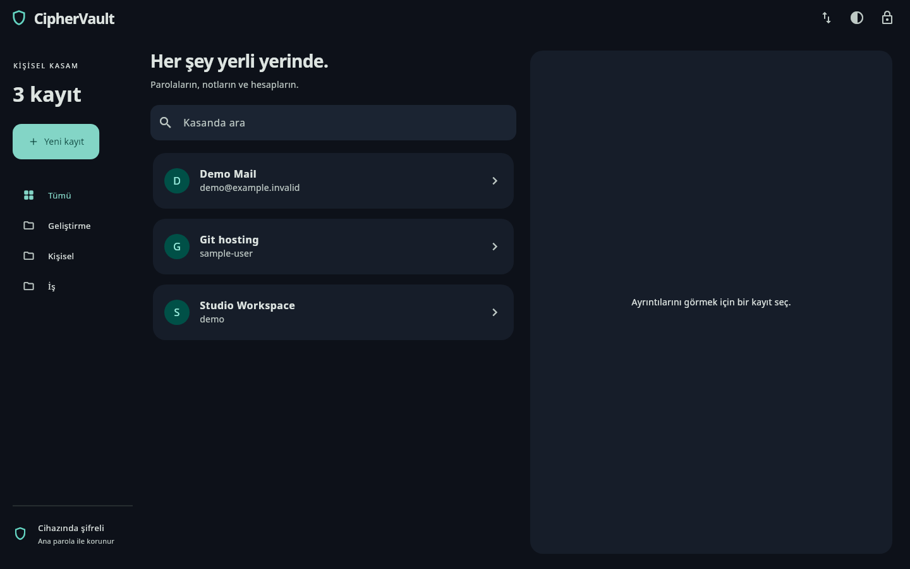
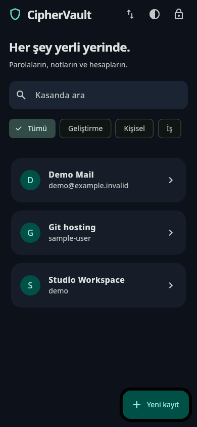

<p align="center"><a href="README.md">English</a> &nbsp; / &nbsp; <a href="README.tr.md">Türkçe</a></p>
<p align="center"></p>
<p align="center"><a href="BUILDING.md">Build from source</a> &nbsp; / &nbsp; <a href="SECURITY.md">Security</a> &nbsp; / &nbsp; <a href="PRIVACY.md">Privacy</a> &nbsp; / &nbsp; <a href="LICENSE">GPLv3</a></p>

<p align="center">One Flutter app for passwords, account details and private notes.<br>A shared encrypted vault format, with a workspace that adapts to mobile and desktop.</p>
<p align="center"><strong>Version 2 is a development preview.</strong> Not independently audited. Existing v1 binaries in Releases belong to the retired implementation.</p>

<p align="center"><a href="test/goldens/desktop.png"></a><br><sub>Desktop preview with sample data.</sub></p>
<details>
<summary>Mobile preview</summary>
<p align="center"></p>
</details>

<h2 align="center">Your vault, on your device</h2>

<table align="center"><tr><th>Store</th><th>Find</th><th>Move securely</th></tr><tr><td>Whole-vault encryption and a master passphrase.</td><td>Search, categories, masked passwords and a password generator.</td><td>Encrypted file backups and separately password-protected QR transfers.</td></tr></table>

<p align="center">Light and dark themes · Background and idle locking · Clipboard timeout · Master-password changes</p>

## Security design

- AES-256-GCM encrypts the complete record list, including titles and usernames.
- Argon2id derives the key from the master passphrase; expensive operations run off the UI isolate.
- Every unlock requires the master passphrase. Late operations cannot unlock a session after it has been locked.
- Fresh nonces, authenticated format headers, bounded inputs and an encrypted previous-version recovery file.
- Multipart QR transfers carry encrypted vault data; old plaintext QR packets are rejected.

Read the [security model and limitations](SECURITY.md). Automated tests do not replace an independent security audit. Back up your encrypted vault: there is no master-password reset service.

## Build and migrate

```bash
git clone https://github.com/idginity124/CipherVault.git
cd CipherVault
flutter pub get
flutter run -d linux
```

See [BUILDING.md](BUILDING.md) for Windows/Android commands, signing, data locations and migration. Python CVLT v0/v1 vaults can be imported. The previous mobile Hive store has an explicit read-only migration path; access depends on the original application identity and signing key. Do not uninstall an existing app before exporting its data.

**Android identity:** `com.bulgan.ciphervault`. Platform runner folders are part of the same Flutter project; the application logic lives in `lib/`.

## Validation and contribution

Linux release build and native launch were verified locally. An Android ARM64 preview was built and signature-checked. Thirteen tests cover encryption interoperability, migration, transfer bounds, session races and responsive UI. Windows native builds and physical Android camera/upgrade checks are still pending. [Validation scope](docs/VALIDATION.md).

[Contributions](CONTRIBUTING.md) are welcome. Do not submit real vaults, passwords or signing keys. CipherVault’s original code is **GPL-3.0-only**; [dependencies and fonts](THIRD_PARTY.md) retain their own licenses.

<p align="center"></p>
<p align="center"><a href="https://www.ekrembulgan.com">Ekrem Bulgan</a> &nbsp; / &nbsp; <a href="https://buymeacoffee.com/ekrembulgan">Support development</a></p>
