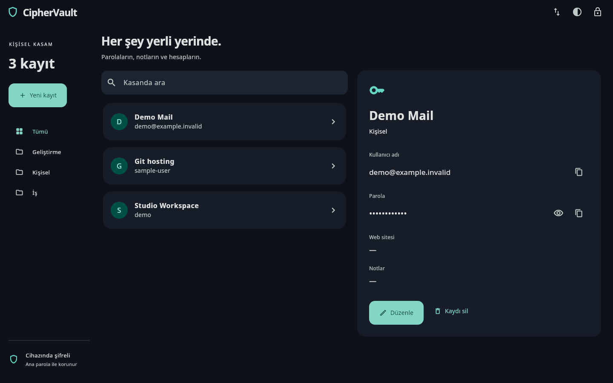

<p align="center"><a href="README.md">English</a> &nbsp; / &nbsp; <a href="README.tr.md">Türkçe</a></p>
<p align="center"></p>
<p align="center"><a href="https://github.com/idginity124/CipherVault/releases/tag/v2.0.1">2.0.1 önizleme paketleri</a> &nbsp; / &nbsp; <a href="BUILDING.md">Kaynak koddan derle</a> &nbsp; / &nbsp; <a href="SECURITY.md">Güvenlik</a> &nbsp; / &nbsp; <a href="PRIVACY.md">Gizlilik</a> &nbsp; / &nbsp; <a href="LICENSE">GPLv3</a></p>

<p align="center">Parolaların, hesap bilgilerin ve özel notların için tek Flutter uygulaması.<br>Mobil ve masaüstüne uyarlanan arayüz, ortak şifreli kasa formatı.</p>
<p align="center"><strong>2. sürüm geliştirme önizlemesidir.</strong> Bağımsız güvenlik denetiminden geçmemiştir. Releases içindeki eski v1 dosyaları önceki uygulamaya aittir.</p>

<p align="center"><a href="test/goldens/desktop-detail.png"></a><br><sub>Görselde yalnızca örnek veriler kullanılmıştır.</sub></p>
<details><summary>Mobil görünüm</summary>
<p align="center"></p>
</details>

<h2 align="center">Kasan, kendi cihazında</h2>
<table align="center"><tr><th>Sakla</th><th>Bul</th><th>Güvenli aktar</th></tr><tr><td>Tüm kayıtları şifreleyen kasa ve ana parola.</td><td>Arama, kategoriler, gizlenen parolalar ve parola üretici.</td><td>Şifreli dosya yedeği ve ayrı parolayla korunan QR aktarımı.</td></tr></table>
<p align="center">Açık/koyu tema · Arka planda ve boşta kilitleme · Pano zaman aşımı · Ana parola değiştirme</p>

## Güvenlik yaklaşımı

- AES-256-GCM; başlık ve kullanıcı adı dahil kayıt listesinin tamamını şifreler.
- Anahtarı ana paroladan Argon2id türetir; ağır işlemler arayüz iş parçacığında çalışmaz.
- Her kilit açılışında ana parola gerekir. Kilitlendikten sonra tamamlanan eski işlemler oturumu açamaz.
- Her kayıtta yeni nonce, doğrulanan dosya başlığı, sınırlanan girdiler ve şifreli önceki sürüm yedeği kullanılır.
- Çok parçalı QR aktarımı şifreli kasa verisi taşır; eski açık metin QR kodları kabul edilmez.

[Güvenlik modeli ve sınırlar](SECURITY.md). Otomatik testler bağımsız güvenlik denetiminin yerine geçmez. Ana parola sıfırlama hizmeti yoktur; şifreli yedeklerini koru.

## Derleme ve eski verileri taşıma

```bash
git clone https://github.com/idginity124/CipherVault.git
cd CipherVault
flutter pub get
flutter run -d linux
```

Windows/Android komutları, imzalama, veri konumları ve aktarım için [BUILDING.md](BUILDING.md) dosyasına bak. Python CVLT v0/v1 kasaları içe aktarılabilir. Eski mobil Hive kayıtları için yalnızca okuyan bir aktarım yolu bulunur; erişim eski paket kimliğine ve imza anahtarına bağlıdır. Veri dışa aktarılmadan mevcut uygulamayı kaldırma.

**Android paket kimliği:** `com.bulgan.ciphervault`. Platform klasörleri aynı Flutter projesinin parçalarıdır; ortak uygulama kodu `lib/` içindedir.

## Doğrulama ve katkı

Linux sürümü derlendi ve gerçek uygulama açılışı denendi. Android ARM64 önizlemesi üretildi, imzası doğrulandı. Şifreleme uyumluluğu, aktarım, geçiş, oturum yarışları ve arayüzü kapsayan 13 test geçti. Windows x64 paketi Windows ortamında derlendi; Store sertifikasyonu ve fiziksel Android kamera/güncelleme kontrolleri henüz tamamlanmadı. [Doğrulama kapsamı](docs/VALIDATION.md) · [Yayınlama rehberi](docs/STORE-GUIDE.tr.md).

[Katkıda bulunabilirsin](CONTRIBUTING.md). Gerçek kasa, parola veya imza anahtarı gönderme. CipherVault’un özgün kodu **GPL-3.0-only** lisanslıdır; [bağımlılıkların ve yazı tiplerinin](THIRD_PARTY.md) kendi lisansları geçerlidir.

<p align="center"></p>
<p align="center"><a href="https://www.ekrembulgan.com">Ekrem Bulgan</a> &nbsp; / &nbsp; <a href="https://buymeacoffee.com/ekrembulgan">Geliştirmeye destek ol</a></p>
